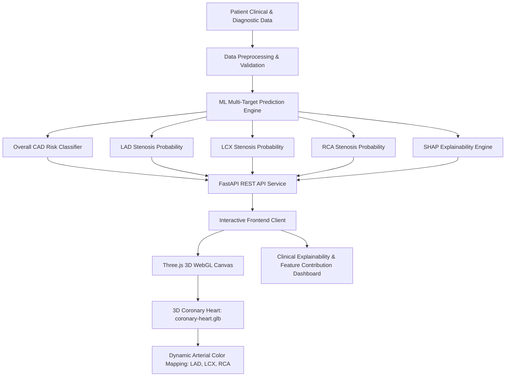

# CardioVista: 3D Cardiovascular Risk Visualization & Prediction

[](file:///mnt/c/Users/Admin/Documents/gokul/CAD-detection/docs/Track_A_Cardiovascular_Challenge.pdf)
[](file:///mnt/c/Users/Admin/Documents/gokul/CAD-detection/docs/ASSET_ATTRIBUTION.md)

**CardioVista** is an interactive multimodal clinical decision-support and visualization platform built for the **Multimodal AI Hackathon 2026 (Track A: Cardiovascular Risk Visualization & Prediction)**. 

The system predicts patient-specific Coronary Artery Disease (CAD) risk and localized multi-vessel stenosis from physiological, laboratory, and echocardiographic data, dynamically mapping localized risks onto an interactive 3D human anatomical heart model in the web browser.

---

## Repository Structure

```
│
├── docs/
│   ├── Track_A_Cardiovascular_Challenge.pdf
│   ├── dataset_columns.csv
│   ├── feature_dictionary.md
│   ├── ASSET_ATTRIBUTION.md
│   └── references/
│       ├── bodyparts3d-catalog.png
│       └── sketchfab-heart.png
│
├── assets/
│   └── 3d/
│       └── source/
│           ├── sketchfab-original/
│           └── bodyparts3d-original/
│
├── frontend/
│   └── public/
│       └── models/
│           └── coronary-heart.glb
│
├── backend/
│   └── model_artifacts/
│       └── README.md
│
├── .gitignore
├── .env.example
└── README.md
```

---

## System Architecture



### Key Modules:
1. **Interactive 3D Anatomical Viewer**:
   - WebGL / Three.js-based rendering of epicardial coronary anatomy (`coronary-heart.glb`).
   - Orbit controls, mesh slicing, and dynamic vessel color coding (Normal $\rightarrow$ Mild Stenosis $\rightarrow$ Severe Stenosis $\ge 50\%$).
   - Interactive vessel selection to inspect branch-specific hemodynamics.
2. **Predictive Machine Learning Engine**:
   - Multi-target risk classification for overall CAD (`Cath`) and epicardial branches: Left Anterior Descending (`LAD`), Left Circumflex (`LCX`), and Right Coronary Artery (`RCA`).
   - Strict target leakage safeguards: Ground truth catheterization variables (`Cath`, `LAD`, `LCX`, `RCA`) are quarantined and excluded from model inputs.
3. **Clinical Explainability (XAI)**:
   - SHAP (SHapley Additive exPlanations) attribution ranking to elucidate key physiological drivers (e.g., Regional Wall Motion Abnormalities, EF-TTE, ST elevation/depression, lipid panel).

---

## Dataset & Feature Documentation

The system utilizes the **Extension of Z-Alizadeh Sani CAD Dataset** from the UCI Machine Learning Repository (303 records, 59 attributes):
- **Feature Dictionary**: See [`docs/feature_dictionary.md`](file:///mnt/c/Users/Admin/Documents/gokul/CAD-detection/docs/feature_dictionary.md) for detailed descriptions, clinical significance, and units for all 59 parameters.
- **Column Registry**: See [`docs/dataset_columns.csv`](file:///mnt/c/Users/Admin/Documents/gokul/CAD-detection/docs/dataset_columns.csv) for machine-readable column categorization.
- **Challenge Guidelines**: See [`docs/Track_A_Cardiovascular_Challenge.pdf`](file:///mnt/c/Users/Admin/Documents/gokul/CAD-detection/docs/Track_A_Cardiovascular_Challenge.pdf).

---

## 3D Anatomical Assets

- **Runtime 3D Model**: [`frontend/public/models/coronary-heart.glb`](file:///mnt/c/Users/Admin/Documents/gokul/CAD-detection/frontend/public/models/coronary-heart.glb) (contains named meshes: `Heart_Body`, `Aorta`, `LAD`, `LCX`, `RCA`).
- **Original Asset Sources**: Documented in [`docs/ASSET_ATTRIBUTION.md`](file:///mnt/c/Users/Admin/Documents/gokul/CAD-detection/docs/ASSET_ATTRIBUTION.md) with visual references in [`docs/references/`](file:///mnt/c/Users/Admin/Documents/gokul/CAD-detection/docs/references/).

---

## Quickstart Guide

### 1. Backend Setup (FastAPI & ML Engine)

```bash
# Create and activate virtual environment
python3 -m venv .venv
source .venv/bin/activate

# Install dependencies
pip install fastapi uvicorn scikit-learn lightgbm xgboost shap pandas openpyxl pydantic

# Configure environment variables
cp .env.example .env

# Start development API server
uvicorn backend.main:app --host 0.0.0.0 --port 8000 --reload
```

### 2. Frontend Setup (Interactive 3D Dashboard)

```bash
cd frontend

# Install node dependencies
npm install

# Start Vite dev server
npm run dev
```

Visit `http://localhost:5173` to launch the interactive 3D cardiovascular inspection tool.

---

## Clinical Safety Disclaimer

> [!CAUTION]
> **Decision Support & Educational Use Only**: This software prototype is developed strictly for research, educational, and clinical decision-support demonstration purposes. The risk estimations and 3D anatomical heatmaps do not constitute formal medical diagnoses, radiological reports, or direct catheterization findings. All diagnostic and therapeutic decisions must be made by licensed healthcare professionals.
